<div align="center">

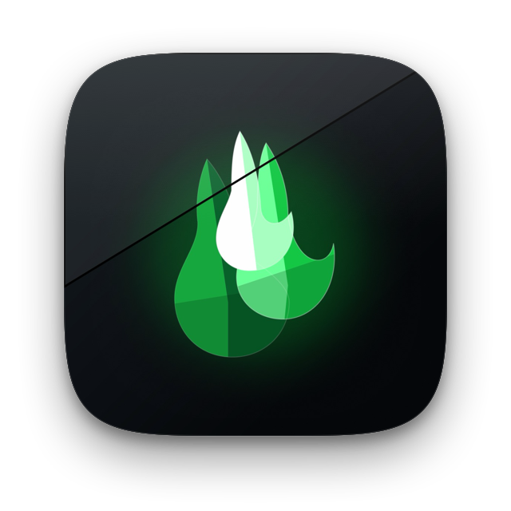

# ASPHYR

**An iOS Personal Growth and Identity Development App**

*Become who you aspire to be, one quest at a time.*

ASPHYR turns real-world self-improvement into a game-inspired journey. You create a character that stands for the person you want to become, then grow it by finishing real quests: studying, practicing a skill, training or finishing a task. Each quest earns XP, attributes and Embers, lights a star on your Journey, and keeps your streak going.

[](#run-the-app)
[](#architecture)
[](#architecture)
[](#testing)
[](#author)

[Screenshots](#screenshots) · [Features](#features) · [Smart difficulty](#smart-difficulty-detection) · [Architecture](#architecture) · [Run the app](#run-the-app) · [Figma design](https://www.figma.com/design/27W7B4MhKAFJ8LwiWJgcmD/ASPHYR)

</div>

<br/>

| **16** | **168 + 8** | **100** | **0** |
|:---:|:---:|:---:|:---:|
| server functions that run the app's rules, so rewards can't be faked from the phone | automated checks on the server's rules and the Delete Account function | stars across five constellations, lit one quest at a time | progress lost for a missed day: the streak rests instead of breaking |

<details>
<summary><b>Table of contents</b></summary>

1. [Overview](#overview)
2. [Screenshots](#screenshots)
3. [The Problem](#the-problem)
4. [The Solution](#the-solution)
5. [Features](#features)
6. [Smart Difficulty Detection](#smart-difficulty-detection)
7. [Who It Serves](#who-it-serves)
8. [Privacy and Fair Play](#privacy-and-fair-play)
9. [How It's Different](#how-its-different)
10. [Limitations and Next Steps](#limitations-and-next-steps)
11. [Architecture](#architecture)
12. [Repository Contents](#repository-contents)
13. [Run the App](#run-the-app)
14. [Testing](#testing)
15. [Documentation](#documentation)
16. [Author](#author)
17. [License](#license)

</details>

---

## Overview

ASPHYR is a native iPhone app built with Swift and SwiftUI, with Supabase as its backend. It connects every small action to an identity the user chooses, so progress feels like becoming someone, not just ticking boxes.

| What you do | What you get |
|---|---|
| Choose who you aspire to become, a colour and an archetype | A character that stands for that person |
| Finish a real quest | XP, attributes and Embers, shown on an animated Reward screen |
| Keep showing up | Levels, a streak flame, achievements and cloaks |
| Keep going | A Journey of five constellations that lights up star by star |

---

## Screenshots

<div align="center">

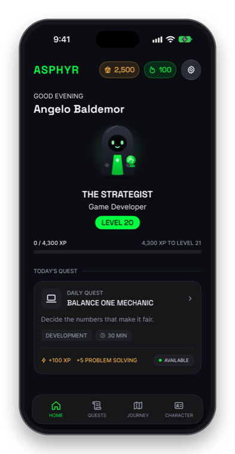
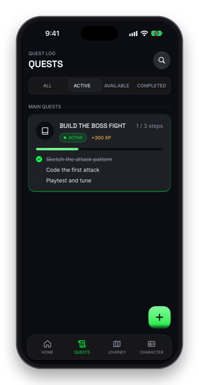
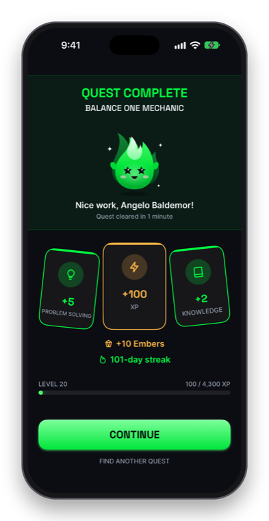
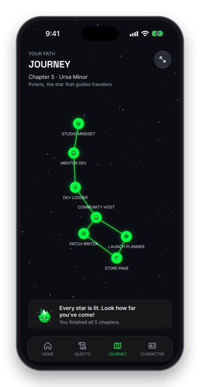
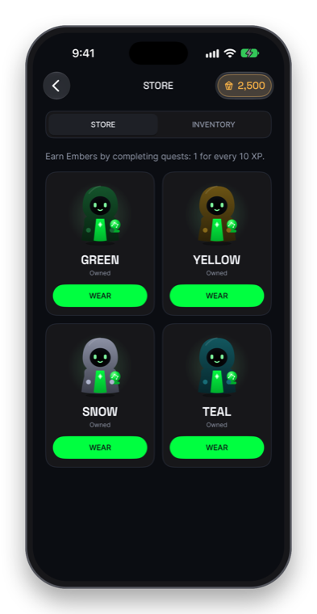

<sub><b>Home</b> · <b>Quest log</b> · <b>Reward</b> · <b>Journey</b> · <b>Store</b></sub>

</div>

<details>
<summary><b>More screens</b></summary>
<br/>

<div align="center">

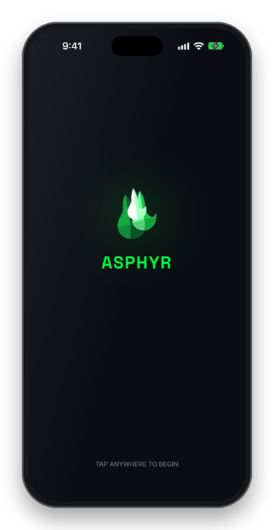
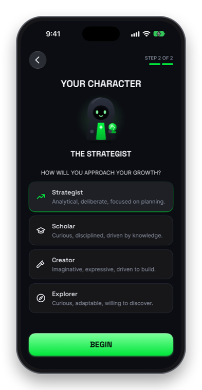
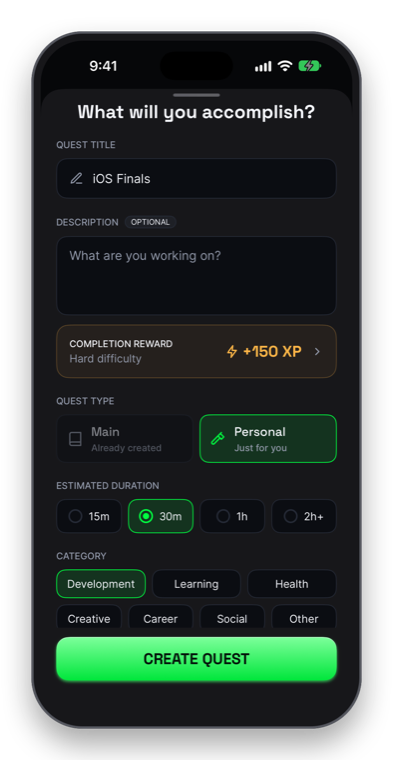
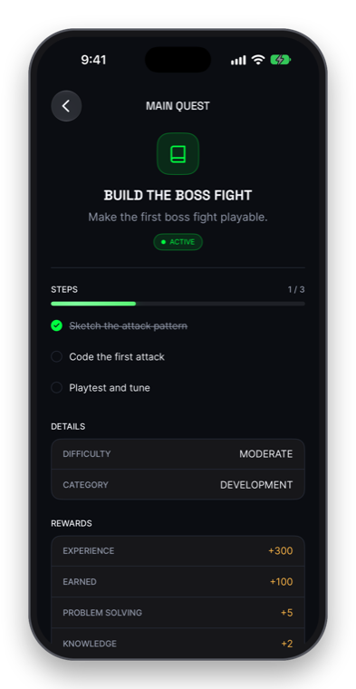
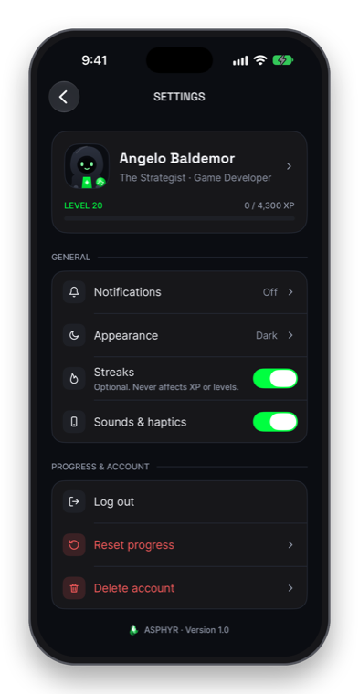

<sub><b>Splash</b> · <b>Archetype</b> · <b>Create Quest</b> · <b>Quest Details</b> · <b>Settings</b></sub>

</div>

</details>

---

## The Problem

Personal growth is slow and mostly invisible. Small actions rarely feel like progress on their own, so many people, especially students, lose motivation before the results show. Most tools either list tasks with no sense of purpose, or punish a missed day by wiping out a streak, which makes people quit.

> **Problem statement.** People who want to grow struggle to stay consistent because they can't see their progress, and the tools they use don't connect daily actions to who they want to become.

---

## The Solution

ASPHYR makes growth visible and keeps it gentle.

| Step | What happens |
|---|---|
| 1. Build an identity | Pick a name, an aspiration (Game Developer, Mechanical Engineer, Psychologist, Doctor, Writer, or your own), a colour and an archetype. |
| 2. Take a quest | A daily quest suggested from your aspiration, a main quest split into steps, or your own personal quests. |
| 3. Do the real thing | Start the quest, follow the timer or tick off the steps, then complete it. |
| 4. See the growth | The server works out the reward, and the Reward screen shows XP, attributes and Embers arriving. |
| 5. Come back | The streak, Journey and level give a reason to return. A missed day lets the flame rest without taking anything away. |

---

## Features

| Area | What it does |
|---|---|
| **Accounts** | Sign up with email or Google, reset a password by email, and delete an account with all its data. |
| **Identity** | A name, an aspiration, one of six character colours and one of four archetypes: Strategist, Scholar, Creator or Explorer, each holding its own item. |
| **Quests** | One daily quest a day, one main quest of 3 to 10 steps, and up to five personal quests of 15, 30, 60 or 120 minutes. Start, pause, edit, abandon or delete them. |
| **Rewards** | XP, four attributes (Knowledge, Discipline, Creativity, Problem Solving) and Embers, revealed on an animated Reward screen. |
| **Progression** | Levels, six achievements, and cloaks that unlock at levels 3, 5 and 8. |
| **Journey** | Five constellations tied to your aspiration, one chapter every 20 quests. |
| **Streaks** | A green flame for days in a row. It rests instead of breaking, and can be hidden. |
| **Store and Inventory** | Spend Embers on cloaks (200 each) and wear one over your character. |
| **Character** | Reacts to you: happy after a quest, sleepy when the streak rests, and it bounces when tapped. |
| **Settings** | Profile photo, Dark, Light or System appearance, reminders, streak alerts, haptics, Reset Progress, Log Out and Delete Account. |

---

## Smart Difficulty Detection

Users never pick a difficulty. ASPHYR reads the quest's words and decides it, and the difficulty sets the reward.

1. The title and description are lowercased and split into whole words, so "Exams" matches but "examine" doesn't.
2. A **Hard** word in the **title** makes the quest Hard. Only the title counts, so a word added to the description can't raise the reward.
3. Otherwise, an **Easy** word in the title or description makes it Easy.
4. Anything else is **Moderate**. Hard always wins: "Tidy my calculus notes" is Hard.

| Level | Words detected |
|---|---|
| Hard (title only) | algebra, algorithm, algorithms, biology, calculus, certification, chemistry, dissertation, exam, exams, finals, geometry, interview, marathon, midterm, midterms, orals, physics, programming, research, statistics, thesis, triathlon |
| Easy (title or description) | dishes, drink, errand, errands, laundry, meditate, nap, stretch, tidy, vacuum, walk, water |

| Quest | Easy | Moderate | Hard |
|---|:---:|:---:|:---:|
| Personal, 30 minutes | 50 XP | 100 XP | 150 XP |
| Main, per step | 50 XP | 100 XP | 150 XP |

The same lists run in the app, to preview the reward while typing, and on the server, which sets the real reward. It is rule-based, not AI, and lives in one place on each side ([`DifficultyEstimator.swift`](Asphyr/Models/Quests/DifficultyEstimator.swift) and `estimate_difficulty`), so a smarter model can replace it later.

---

## Who It Serves

| User | What they get |
|---|---|
| **Students** | Study habits and course practice that visibly add up. |
| **Young people starting a path** | Direction toward an identity such as game developer, engineer, writer or doctor. |
| **Anyone who struggles with consistency** | Visible rewards, levels and a streak that forgives a missed day. |
| **Teachers, mentors and parents** | Indirectly, an honest picture of the work done through the quest log and progress. |

---

## Privacy and Fair Play

- **Rewards are decided on the server.** XP, attributes, Embers, daily limits and Store purchases are worked out by server functions using the server's own clock, so changing the phone's date does nothing.
- **Each user sees only their own data.** Row-level security on every table limits each account to its own rows.
- **The app can't write to the quest tables.** Every change goes through a server function that checks the request first.
- **Daily limits keep it fair.** 3 full-reward personal quests a day (a flat 10 XP after that), 3 main quest steps a day, and one daily quest.
- **Only what's needed is collected.** Sign-in details, name, character choices, aspiration, quests and an optional photo. Nothing is shared or sold.
- **Delete Account removes everything:** the login, every row and the photo.

---

## How It's Different

| | To-do list | Typical habit tracker | **ASPHYR** |
|---|:---:|:---:|:---:|
| Connects actions to who you want to become | ✗ | ✗ | ✓ |
| A character that grows with you | ✗ | Sometimes | ✓ |
| Rewards checked on a server | ✗ | Rarely | ✓ |
| A missed day takes nothing away | — | ✗ | ✓ |
| Difficulty judged from the quest's words | ✗ | ✗ | ✓ |

---

## Limitations and Next Steps

**Limitations**

- **Honour system.** The app can't prove a real-world quest was done. The minimum time and daily limits keep fake progress slow and small.
- **Keyword difficulty.** It knows 35 English words and can't read context.
- **Needs internet.** Every quest action is checked by the server.
- **Sharing.** Installs from Xcode last 7 days; TestFlight needs the Apple Developer Program.
- **The quest log grows.** Finished quests are kept with no search or archive yet.
- **iPhone only**, iOS 26.5 or later, portrait.
- **No outside testers yet.** A test with friends is planned.

**Next steps**

1. Character stages at level 10 (Adept) and level 20 (Ascended).
2. Quest log search and filters, and a log that folds old quests into a summary.
3. A premium UI/UX redesign.
4. Smarter, AI-based difficulty.
5. A test with friends, then TestFlight.

---

## Architecture

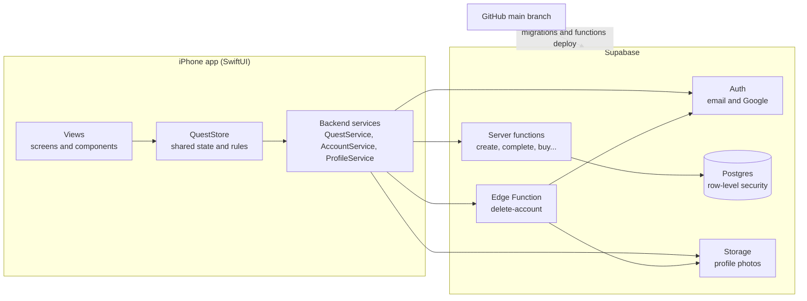

Each layer only talks to the one below it: a screen asks the store, the store asks a service, and the service asks the server.

| Layer | Technology |
|---|---|
| App (`Asphyr/`) | Swift, SwiftUI, Observation |
| Backend (`supabase/`) | Supabase: Auth, Postgres with row-level security, PL/pgSQL server functions, Storage, a TypeScript Edge Function |
| Client library | [supabase-swift](https://github.com/supabase/supabase-swift), through Swift Package Manager |
| Delivery | GitHub; merging into `main` deploys database changes and the Edge Function |
| Design | Figma |
| Tests | Shell rule tests, Postgres database tests, Deno tests for the Edge Function |

---

## Repository Contents

```
asphyr-app/
├── Asphyr/                      # The iPhone app
│   ├── AsphyrApp.swift          # Entry point
│   ├── Views/                   # Screens: App, Onboarding, Authentication, Home,
│   │                            #   Quests, Journey, Character, Store, Settings
│   ├── Components/              # Reusable pieces: buttons, inputs, cards, the character
│   ├── Models/                  # State and rules: profile, quests, rewards, streaks, Journey
│   ├── Backend/                 # The only code that talks to Supabase
│   ├── DesignSystem/            # Colours and typography
│   └── Assets.xcassets/         # Colour sets, icons and character art
├── supabase/
│   ├── migrations/              # Tables, security rules and server functions, in order
│   ├── functions/               # Edge Functions: delete-account
│   ├── tests/                   # Database tests
│   └── demo/                    # Fills a demo account with progress
├── scripts/                     # Test runners: rule-tests and db-tests
├── docs/                        # Specs, notes and README assets
└── README.md
```

---

## Run the App

You need a Mac with **Xcode 27.2** or later, and an iPhone or simulator on **iOS 26.5** or later.

1. Clone the repository:

   ```bash
   git clone https://github.com/raccdude/asphyr-app.git
   ```

2. Open `Asphyr.xcodeproj` in Xcode. Swift Package Manager downloads supabase-swift on the first build.
3. In **Signing & Capabilities**, choose your own team. A free Apple ID is enough to run it on your own iPhone.
4. Pick a simulator or a connected iPhone and press **⌘R**.

> [!NOTE]
> The app connects to the project's Supabase backend with its publishable key, which is safe to ship in an app because row-level security limits what it can do. No other setup is needed.

---

## Testing

| Suite | Command | What it checks |
|---|---|---|
| Rule tests | `zsh scripts/rule-tests/run.sh` | Reward, settings and onboarding rules, without Xcode |
| Database tests | `zsh scripts/db-tests/run.sh` | 168 checks on the server's quest, reward, photo and security rules on a fresh local database, plus 8 tests for the Delete Account function |

> [!NOTE]
> The database tests need a local Postgres (`brew install postgresql@17`) and, for the function tests, Deno (`brew install deno`). They never touch the real data.

Every change was also tested by hand on an iPhone 12 Pro Max before it was merged.

---

## Documentation

| Document | What's inside |
|---|---|
| [Design decisions](docs/DESIGN-DECISIONS.md) | Why the app looks and behaves the way it does |
| [Implementation notes](docs/IMPLEMENTATION-NOTES.md) | How each screen and rule was built, and what's planned |
| [Backend spec](docs/BACKEND-SPEC.md) | The Supabase design, step by step |
| [XP system](docs/XP-SYSTEM-SPEC.md) | Levels, rewards and limits |
| [Journey constellations](docs/JOURNEY-CONSTELLATIONS-SPEC.md) | The five chapters and their stars |
| [Release checklist](docs/RELEASE-CHECKLIST.md) | What to do before sharing the app |

---

## Author

**Angelo Buedo** · BSCS, Software Engineering · Finals project, 2026

---

## License

No licence has been chosen yet, so all rights are reserved by default.

<br/>

<div align="center">


**ASPHYR** · Become who you aspire to be

*You don't have to become that person today. Just take one step.*

</div>
